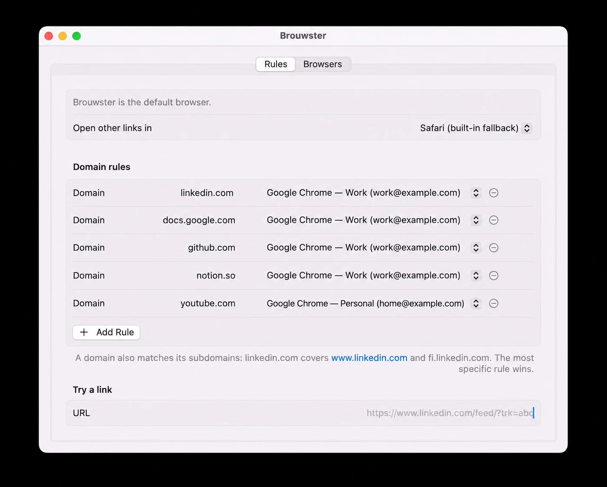

# Brouwster

A macOS "browser" that never shows a web page. Set it as the default browser and it:

1. strips tracking parameters (`utm_*`, `fbclid`, LinkedIn `trk`/`rcm`, X `s`/`t`, YouTube/Spotify `si`, newspaper share ids…) from the link, and
2. opens the cleaned link in the browser — or a Chrome/Edge/Brave/Vivaldi/Firefox **profile** — chosen by your domain rules.

A rule for `linkedin.com` matches `linkedin.com` and every `*.linkedin.com`. The most specific rule wins; other links go to the default target (Safari if none is set).



## Build and install

```sh
swift test                   # run the test suite
scripts/bundle.sh --install  # build, copy to ~/Applications and register with Launch Services
open ~/Applications/Brouwster.app
```

Open Brouwster to get the settings window, then **Make Default Browser** (macOS asks for confirmation). Opening it again from Finder/Spotlight brings the settings back; while routing links it runs without a Dock icon.

Config lives in `~/Library/Application Support/Brouwster/config.json`.

## Layout

- `Sources/BrouwsterCore` — tested logic: `URLCleaner`, `Router`, `ChromiumProfileScanner`, `FirefoxProfileScanner`, `LaunchPlan`, `ConfigStore`.
- `Sources/Brouwster` — thin AppKit/SwiftUI adapters: Launch Services browser discovery, URL handling, settings UI.
- `open Package.swift` opens the project in Xcode.

## License

MIT, see [LICENSE](LICENSE).
